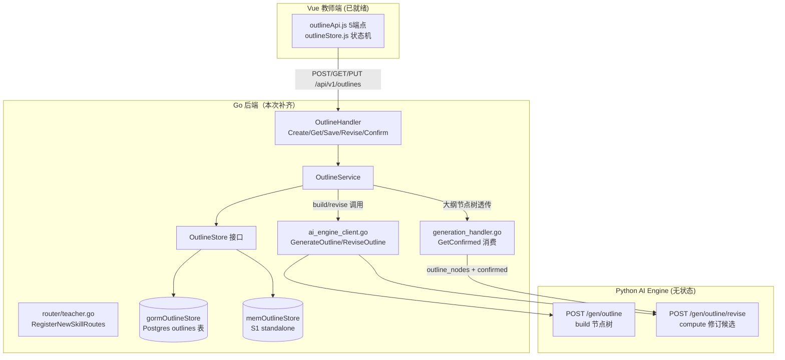
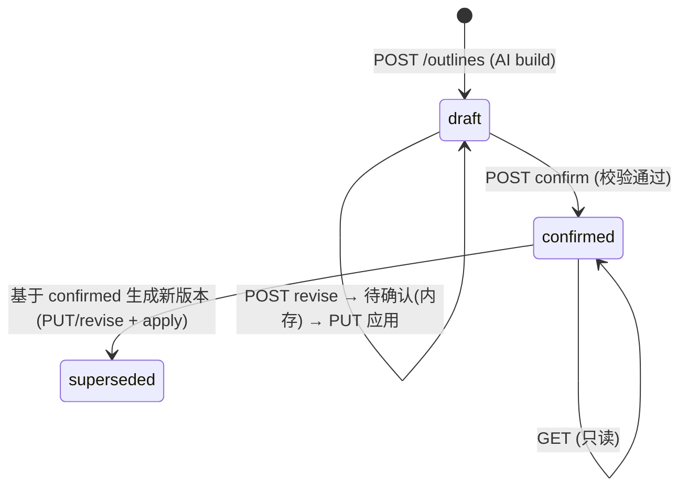

> **Model: deepseek-v4-flash-0731 (cheap)**

# 补齐 S3 Outline 后端缺口并修复编译（成员 D 交接后续）

> **Status: 待提交**

## 需求提炼

**目标（用户原话）**："需要先拉取一下远程 确保最新进度" → 已确认本地=远程=bc4c8fd，远程无缺失文件；随后确认"全部补齐并按照文档要求修复 实现完整功能"。

用户意图拆解（三层）：
1. **编译阻断修复**：`go build ./...` 当前失败（6+ undefined 符号），必须恢复可编译。
2. **按文档补齐**：按《文档/S3数据与接口规范.md》v1.0 实现缺失的 Go 后端 S3 大纲业务层，使"大纲草稿→AI 修订→保存版本→确认→进入内容生成"链路功能完整。
3. **契约对齐**：补齐后 Go 网关与 Python AI Engine、Vue 教师端（outlineApi.js / outlineStore.js 已按规范就绪）三方字段/状态/响应结构一致。

**非目标**：
- 不修改 Python AI Engine 大纲端点（已无状态、正确）。
- 不修改前端（outlineApi/outlineStore 已按规范实现并消费新契约）。
- 不做 S4 版本/导出等其他模块的重构（交接报告标注的其它阻塞项另有归属）。
- 不在本轮迁移 /api/v1/gen/* 旧接口（规范 §5 明确"新接口与旧接口并行"）。

**验收证据**：
- `cd backend && go build ./...` exit 0。
- 新增 Go 单测覆盖 OutlineService 状态机与校验逻辑并全绿。
- outline 端点请求/响应字段与《文档/S3数据与接口规范.md》§3.1-3.5 及前端 outlineApi.js 一致。

## 现状（取证摘要，锚点=证据）

### 编译失败面（全在 Go，Python/前端无缺失）

| 引用点（file:line） | 缺失符号 |
|---|---|
| backend/internal/service/ai_engine_client.go:559,998-1007 | `OutlineNode`, `OutlineGenerateRequest`, `OutlineGenerateResponse`, `OutlineReviseAIRequest`, `OutlineReviseAIResponse` |
| backend/internal/handler/generation_handler.go:17,20-40 | `service.OutlineService`（struct/字段）、`GetConfirmed`, `ErrOutlineNotFound` |
| backend/cmd/teacher/main.go:130-132,199-201 | `service.NewOutlineService` |
| backend/cmd/teacher/main.go:131,200 | `handler.NewOutlineHandler` |
| backend/internal/router/teacher.go:125,159-165 | `handler.OutlineHandler` |

git log --all 证实：`backend/internal/handler/outline_handler.go` 与 `backend/internal/service/outline_service.go` **从未提交**（接口契约先行的装配已入仓、实现文件丢失）。

### 已确认的外部契约（不变量）

**Python AI Engine（ai_engine/main.py）**：
- `POST /gen/outline`（main.py:657）：`GenOutlineRequest` = intent(dict)/evidence_packet/markdown/course_name；返回裸 `{"nodes": [...], "used_fallback": ...}`。无状态。
- `POST /gen/outline/revise`（main.py:671）：`GenOutlineReviseRequest` = nodes(list[dict] 必填)/message(str 必填)；返回 `{"nodes", "change_summary"}`。docstring（:673）："版本和确认态仍由 Go 后端管理"。
- OutlineBuilder（ai_engine/gen/outline.py）build/revise 均为纯函数。
- 节点 canonical 字段（schema.py normalize）：node_id/title/summary/source_span/node_type/type/prerequisites/key_points/core_points/questions/interactive_questions/segments/layout_hint/font_size_hint/text_alignment/slide_background。

**《文档/S3数据与接口规范.md》v1.0**：
- 状态机：`draft → confirmed → superseded`（§2.3, L148-151）。确认后不得原地覆盖，修改确认大纲须生成新 outline_version、旧版本保留。
- OutlineNode 必填：node_id/order/title/summary/node_type/key_points/estimated_duration_minutes；可选 source_chunk_ids/interactive_plan。node_type ∈ content/section/quiz/interactive/summary。**禁止** script/segments/interactive_items（§2.1 L66-100）。
- 5 端点：POST /outlines、GET /outlines/{id}?version=N、POST /{id}/revise、PUT /{id}（base_version 冲突 409）、POST /{id}/confirm（§3.1-3.5 L274-371）。
- 错误结构：`{code, error:{error_code, message, request_id}}`，错误码含 OUTLINE_NOT_FOUND(404)/OUTLINE_NOT_CONFIRMED(409)/OUTLINE_VERSION_CONFLICT(409)/INVALID_OUTLINE(422)（§4）。
- Outline 对象：outline_id/outline_version/session_id/intent_id/status/title/nodes/created_at/updated_at/confirmed_at。
- 一致性（§6）：outline_id+outline_version 唯一；已确认大纲不被生成流程重建。

**前端（teacher）**：outlineApi.js 5 端点已按规范实现；request.js 要求响应 `payload.code === 200`（Go 网关统一包 `{code, data}`）；outlineStore.js 状态机含 `confirming`（前端过渡态，后端不返回）；Store 的 _applyOutlineData 读 data.outline_id/outline_version/status/title/confirmed_at/nodes[]/session_id/intent_id。

**Go 装配约束**：backend/cmd/teacher/main.go 完整模式(db 就绪)与 runS1Standalone(db 不可用→S1 轻量) **两处都**调 `service.NewOutlineService(aiClient)`（main.go:130 与 199）+ `NewOutlineHandler(outlineService)`——构造签名当前单参，不能要求 db 实参。teacher main **不初始化 Redis**（repository 包仅 backend/api/main.go 用），故 OutlineService 持久化不能依赖 Redis。

### 缺失符号期望形状（由引用点反推）

- `service.OutlineNode`：导出 struct；`GenerationCreateRequest.OutlineNodes []OutlineNode`（json:"outline_nodes"）→ 发往 Python 时需与 normalize 节点兼容（无 order 也行，但规范要求有 order——需取舍，见下）。
- `service.OutlineGenerateRequest/Response`：调用 `/gen/outline`，字段 = session_id/intent_id/intent/evidence_packet/markdown/course_name → 响应 nodes。
- `service.OutlineReviseAIRequest/Response`：调用 `/gen/outline/revise`，字段 = nodes/message/base_version/auto_apply → 响应 nodes/change_summary。
- `service.OutlineService`：struct 含 aiClient + storage；方法 Create/Get/Save/Revise/Confirm/GetConfirmed。
- `handler.OutlineHandler`：Create/Get/Save/Revise/Confirm 五 handler。
- `ErrOutlineNotFound`：哨兵 error（generation_handler.go:38 `errors.Is(err, service.ErrOutlineNotFound)`）。

## 关键决策与取舍

### D1：OutlineService 存储抽象（db 可用 vs standalone）

两处构造点签名一致（单参 aiClient），但完整模式有 `*gorm.DB`、S1 模式无。方案：

- `service.OutlineStore` 接口：`Create(ctx, *Outline) error` / `GetLatest(ctx, outlineID)` / `GetVersion(ctx, outlineID, version)` / `SaveVersion(ctx, *Outline)` / `UpdateStatus(...)` / `ListVersions(...)`。
- `gormOutlineStore`（Postgres 表 `outlines`，JSON 列存 nodes）+ `memOutlineStore`（进程内存 + 互斥锁，S1 模式降级）。
- **签名兼容**：保留 `NewOutlineService(aiClient)` 单参（内部默认 mem 存储），新增 `NewOutlineServiceWithStore(aiClient, store)`；main.go 完整模式在 db 就绪分支改为传入 gorm store，S1 standalone 保持单参默认 mem。
  - 理由：改动最小且不破坏 runS1Standalone；完整链路（db 模式）获得真正的跨重启持久化。

### D2：OutlineNode 是否带 `order` 字段

- S3 规范 OutlineNode 必填 `order`；但 Python normalize 节点无 order（用 list 下标）。
- `GenerationCreateRequest.OutlineNodes` 透传给 Python `/api/v1/gen/create`，Python 侧 `outline_nodes: list[dict]` 直接消费，多余字段不影响（dict 宽松）。
- 决策：service.OutlineNode **带 order**（满足规范与前端校验），发 Python 时原样透传（Python 忽略 order）；Go 内部校验与排序用 order。字段名对齐规范 snake_case。
- 节点结构取舍：含 title/summary/node_type/key_points/estimated_duration_minutes/source_chunk_ids/interactive_plan；**不含** script/segments/interactive_items（规范 §2.1 禁止）。

### D3：state 常量与 `confirming`

- Go 只存 draft/confirmed/superseded（规范三态）；`confirming` 是前端本地过渡态（outlineStore.js 注释已确认）。
- state 用 string 常量：`OutlineStatusDraft = "draft"` 等。

### D4：OutlineGenerateRequest 调 `/gen/outline` 前缀问题

现有客户端方法路径写死 `/gen/outline`（ai_engine_client.go:1000），而 Python 路由确实是无前缀的 `/gen/outline`（main.py:657 等一批 /gen/* 无 /api/v1），baseURL 已含端口。**不改**——它与其它 /gen/* 一致（/gen/content 等），且 postJSON 不做前缀拼接（路径原样接在 baseURL 后）。对照 ai_engine_client.go:1000 与 main.py:657 是匹配的。后续 Get/Confirm 由 OutlineService 直接调 Python 两个端点或本地存储——确认/版本链是 Go 职责（Python 无对应端点），Save/Get/Confirm 走本地 store。

### D5：错误结构

Go handler 沿用现网响应风格 `{"code": N, "message": ...}`（generation_handler 等一致），错误码用规范 §4 error_code 放入 message 或单独字段——**保持与现有 Go handler 一致**（generation_handler.go:30 `{"code":400,"message":...}`），不引入 request_id（现网无）。service 暴露哨兵 `ErrOutlineNotFound`/`ErrOutlineVersionConflict` 供 handler 映射 HTTP 404/409。

### D6：Outline model 归属

在 `service` 包定义 Outline/OutlineNode 等 struct（与 ai_engine_client.go 同一包，DTO 与业务实体一处），不动 model 包（model 现有表为课程/学习域，无大纲表）。gorm store 的表映射用单独 gorm.Model 结构。

## 架构图

状态机：

## 待办任务（RED→GREEN 分波）

### Wave 0：复现编译失败（RED 基线）

- [x] 复现：`go build ./...` 已失败（6+ undefined）——RED 已持有（plan 前取证）。

### Wave 1：service 层补齐（缺失定义落盘）

- [t1] ai_engine_client.go 补 DTO：`OutlineNode`, `OutlineGenerateRequest`, `OutlineGenerateResponse`, `OutlineReviseAIRequest`, `OutlineReviseAIResponse`。
- [t2] 新建 internal/service/outline_service.go：Outline 实体、OutlineStore 接口 + mem/gorm 实现、OutlineService（Create/Get/Save/Revise/Confirm/GetConfirmed）、状态常量、哨兵 error。
- [t3] 补 gorm store 的表 AutoMigrate 注册（cmd/teacher/main.go db 就绪分支加 outline 模型迁移）。
- [验证] `go build ./...` GREEN（service 包内引用闭环）。

### Wave 2：handler + 装配

- [t4] 新建 internal/handler/outline_handler.go：OutlineHandler 5 端点，字段映射与错误映射（404/409/422）。
- [t5] 修正 cmd/teacher/main.go 装配（完整模式传 gorm store；S1 standalone 默认 mem）。
- [验证] `go build ./...` GREEN + `go vet ./...`。

### Wave 3：测试（RED→GREEN）

- [t6] 写 outline_service_test.go：状态机流转（draft→confirmed→superseded）、版本冲突 409、GetConfirmed 校验、node_id 重复/order 不连续校验、确认后不可原地覆盖。
- [t7] 写 outline_handler_test.go（httptest）：5 端点请求→响应 code/data 结构、404/409 映射。
- [验证] `go test ./internal/service/... ./internal/handler/...` 全绿；随后 `go build ./...` + `go vet ./...` 复跑。

### Wave 4：契约对齐核对（瑶光反证）

- [t8] 对照《文档/S3数据与接口规范.md》§3.1-3.5 与前端 outlineApi.js 逐字段核对；对照 Python GenOutlineRequest/revise 字段核对 service 调用体。
- [t9] 端到端冒烟（可选，视环境）：起 Go teacher + Python AI Engine，curl POST /api/v1/outlines 走通 create→save→confirm→GET。

## 反证/复现（瑶光反证章节）

- **断言 A**（编译失败面=6 符号）：plan 期已用 `go build ./...` 复现，逐条对应 file:line ✓。
- **断言 B**（Python 无大纲状态、无 confirm 端点）：grep @app 清单 33 路由无 /outlines；docstring main.py:673 ✓（证据=scout 一手摘录，plan 期已读路由清单）。
- **断言 C**（两处 NewOutlineService 装配、S1 无 db）：backend/cmd/teacher/main.go:130/199 直读 ✓。
- **断言 D**（request.js 要求 code===200）：直读 ✓。
- **待验证假设 H1**：新增 gorm store 后 AutoMigrate 在既有库成功（无现成 CI/DB，实测需本地 Postgres；未起则标记"未验证"）。
- **待验证假设 H2**：端到端链路（教师端→Go→Python）需真实 LLM/环境，本地无则标记"未验证"。

## 变更文件清单

| 文件 | 动作 |
|---|---|
| backend/internal/service/ai_engine_client.go | 改：补 5 个缺失 DTO |
| backend/internal/service/outline_service.go | 新建 |
| backend/internal/service/outline_service_test.go | 新建 |
| backend/internal/handler/outline_handler.go | 新建 |
| backend/internal/handler/outline_handler_test.go | 新建 |
| backend/cmd/teacher/main.go | 改：gorm store 装配 + AutoMigrate |
| backend/internal/router/teacher.go | 改（若需）：确认参数透传/无需则不动 |

## 验证命令核销表

| 命令 | 预期 | 状态 |
|---|---|---|
| `cd backend && go build ./...` | exit 0 | 未跑（计划后） |
| `go vet ./...` | exit 0 | 未跑 |
| `go test ./internal/service/ ./internal/handler/` | 全绿 | 未跑 |
| `go test ./...` | 全绿 | 未跑 |
