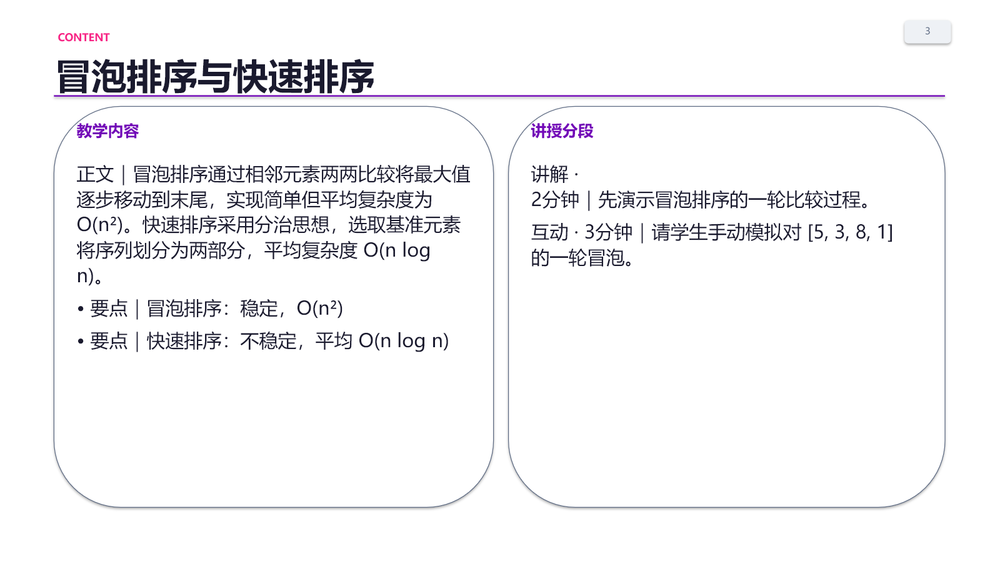
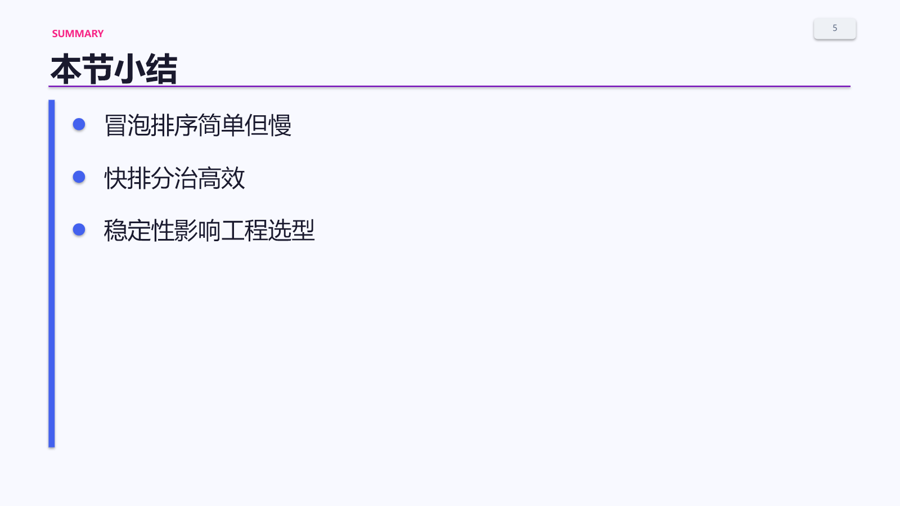
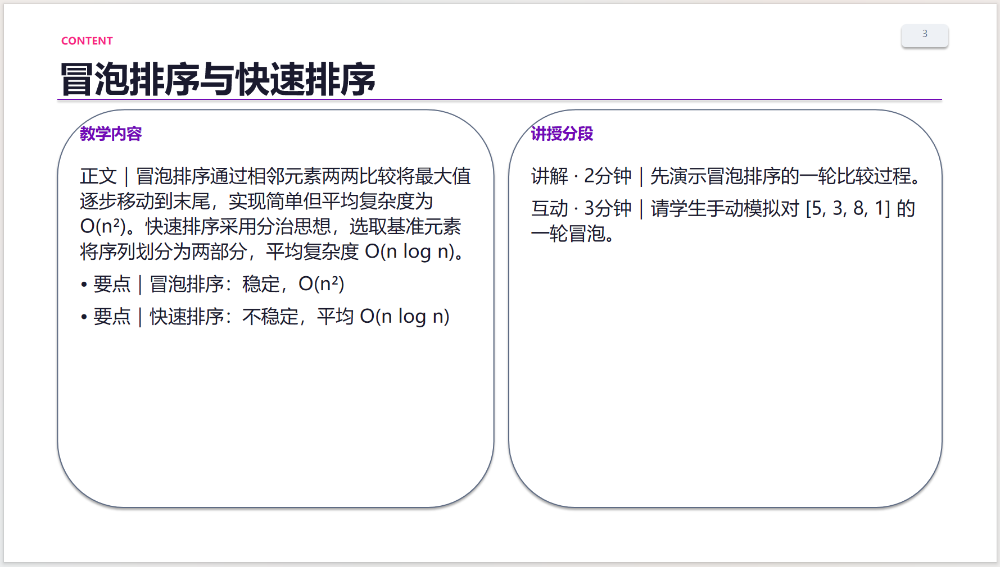
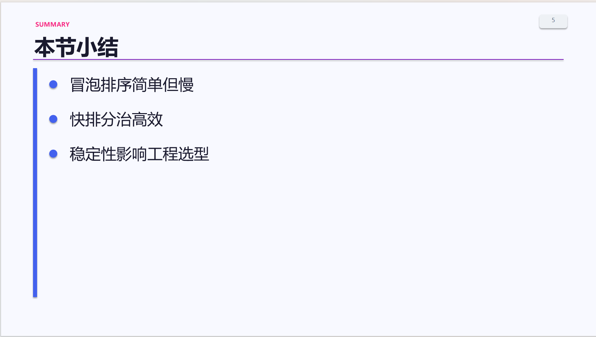

# M3-2 + M3-3 导出链路与 PPTX 质量交付报告

负责人：成员3 / 向洋

日期：2026-08-30

基线：`origin/main@34a9c7c`

## 1. MinIO 审计结果

结论：**原缺失已在主干修复，本轮复核通过；真实服务联通仍需部署环境凭据。**

- 按任务命令检查 `ai_engine/main.py`：当前没有旧式 `minio_client.upload_file()` 直调。
- `_run_export` 在 PPTX/DOCX 文件落盘后调用 `ai_engine.gen.export_upload.upload_export_file()`。
- `upload_export_file()` 内部使用 MinIO SDK 的 `fput_object()`，包含 bucket 存在性预检和自动创建。
- 上传结果明确区分 `uploaded / failed / skipped`；失败时保留本地导出文件且任务状态仍为 `done`。
- `BOTH` 模式会分别上传 PPTX 和 DOCX，不再漏传第二个文件。

验证：`python scripts/verify_export_upload.py`，**21/21 PASS**。覆盖未配置、缺包、成功、建桶、异常降级、文件缺失、`_run_export` 失败/成功契约和 BOTH 双文件上传。

> 当前机器没有可用 MinIO 服务，本轮通过 mock 客户端走真实代码路径验证。部署环境需配置 `MINIO_ENDPOINT / MINIO_ACCESS_KEY / MINIO_SECRET_KEY / MINIO_BUCKET / MINIO_USE_SSL` 后补一次真实上传联通测试。

## 2. PPTX 与预览同源修复

本轮读取 `preview.py` 作为唯一视觉和类型识别基准，只修改导出侧：

1. 页面类型优先级改为与预览一致：`type` 优先，`node_type` 兜底；冲突字段不再造成预览/导出版式分叉。
2. 默认主题改为预览同款令牌：蓝 `#4361EE`、紫 `#7209B7`、洋红 `#F72585`、正文 `#1A1A2E`、白底。
3. 封面采用 Office/WPS 原生蓝紫线性渐变；章节页采用洋红到紫色渐变，均保持可编辑，无整页图片。
4. 页码改为右上角胶囊，标题区预留安全宽度，避免重叠。
5. `interactive` 不再退化为粉色 `quiz`，增加绿色互动页，与 HTML 预览分轨一致。
6. 测验页、互动页、小结页分别使用浅粉、浅绿、浅蓝背景；小结强调色回归预览蓝色。
7. 保留已合入的 WPS 中文字体修复：每个中文文本 run 写入 `a:ea="微软雅黑"`。

## 3. 自动化测试与视觉证据

| 验证项 | 结果 |
|---|---:|
| `pytest ai_engine/gen/tests/test_export_task.py -q` | 35 passed + 3 subtests |
| `pytest ai_engine/gen/tests/test_all.py -q` | 35 passed + 5 subtests |
| `scripts/verify_export_upload.py` | 21/21 PASS |
| `scripts/verify_export_pptx.py` | 8/8 PASS |
| `scripts/verify_preview_render.py` | 全部 PASS |
| PPTX 重开与结构检查 | 6 页、无空白页、`a:ea` 80 处、无图片/图表/SmartArt |

样例文件：`docs/导出验证/sample_export.pptx`

自动渲染检查图（封面 / 内容 / 小结）：

## 4. WPS 验证状态

- 本机安装版本：**WPS Office 12.1.0.28043**（注册表安装信息核验）。
- 实机验证文件：`docs/导出验证/sample_export.pptx`。
- 打开结论：无文件损坏或修复提示；封面渐变、中文字体、内容双栏、小结要点和页码均正常。
- 编辑兼容：全部内容为原生文本框、基础形状和原生渐变，16:9 可编辑；无图片伪导出、无 SmartArt、无外部资源依赖。

WPS 实机截图（封面 / 内容 / 小结）：

## 5. 结论

- MinIO 导出上传链路：**代码与离线真实路径验证通过**；真实服务联通待部署环境复验。
- PPTX 与预览一致性：**已修复类型优先级、默认色板、封面/章节渐变、互动分轨和页码位置**。
- Office/WPS 可编辑兼容：**自动检查与 WPS 12.1.0.28043 实机验证均通过**。
- M3-3 WPS 截图：**封面、内容、小结三张证据已归档，交付项完成**。
