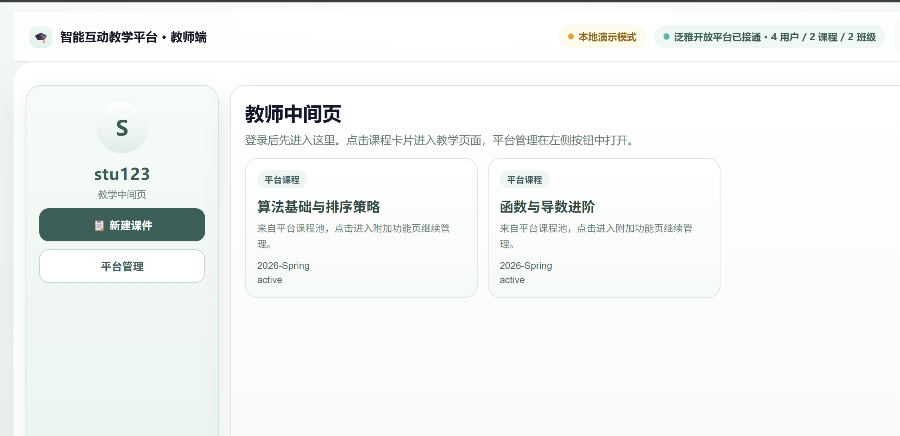
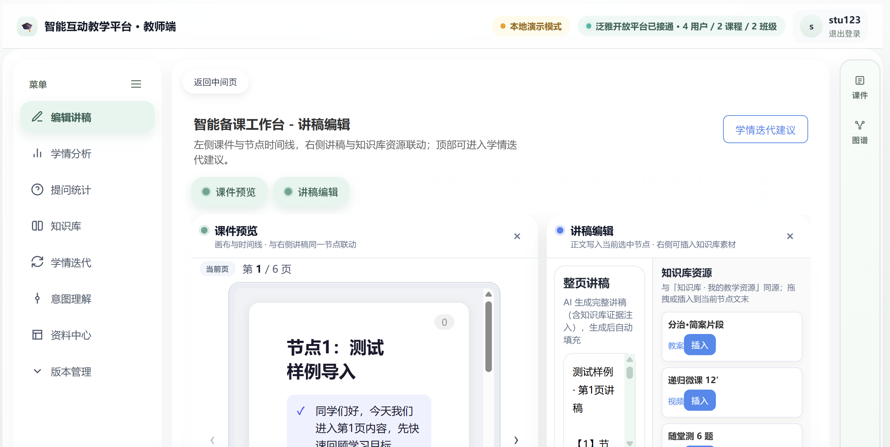
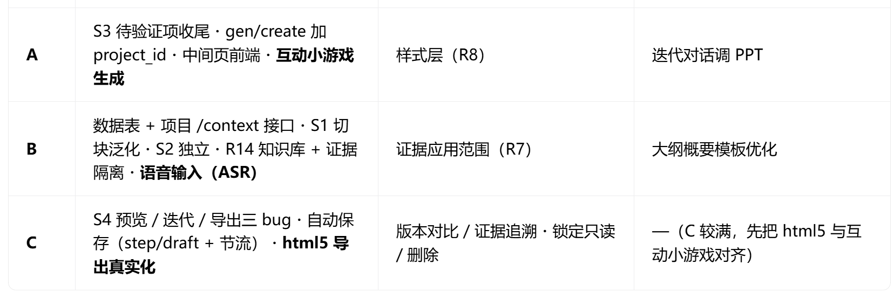

# 流程和页面功能的修改 副本

# 一、问题描述

本章只描述现状问题、影响面与严重程度，不混入实现方案；对应解决思路见第三章，实施排序见第四章。落地状态以当前代码为准。

## 1\.1 问题清单

|页面|问题|落地状态|
|---|---|---|
|中间页|若“新建”直接清空缓存，教师编辑中途退出后再进入将无法继续|🟡 部分缓解（刷新可恢复；“从中间页继续编辑”入口未实现）|
||中间页仍展示“平台课程”及课程 mock 数据，看不到自己的课件，无法继续编辑|🕐 仍存在（现状未改）|
||中间页跳转进入平台管理 / Workspace 逻辑，与“教师自用课件生成”定位不符|🕐 仍存在（“平台管理”入口与组件保留）|
|S2<br>|S2（资料上传 / RAG）是主流程必经步骤，无资料或资料未就绪时无法生成|🟡 已缓解（S1 页可直达 S3；S3 支持无资料生成模式）|
||知识库待添加接入||
|全局|证据包存于全局缓存，多课件、多草稿之间易发生数据混淆|🟡 部分（证据包仍为全局单键；生成模式已按 sessionId 键控）|
|S3<br><br>|“证据绑定”概念混用：草稿证据池、页面引用、正式版本证据未区分，改一页或补一条证据可能触发整个课件重新生成|🕐 规划中|
||左侧箭头拖动节点顺序拖动不了||
||**AI修订**不能实际成功添加节点（在大纲页也无法显示）||
||在大纲编辑这里**手动添加**节点，内容无法传递到内容生成和页面管理||
||没有支持调整样式||
||迭代对话调整ppt||
||互动小游戏无法生成||
|S4<br>|html课件预览接口接的是旧的||
||html5导出是mock数据||
||对于节点的修改实施不了，无法迭代新版本（迁移到S3）||
||导出时显示字母乱码，无法确认导出对象|🕐 仍存在（S4 版本详情已显示 vN，导出流程未带版本号）|
|全局|保存概念模糊（自动保存 / 保存版本混用），用户不清楚何时保存了什么|🕐 仍存在（现状为各 store 手动持久化）|
|S1|AI有点笨，比如列举讲述知识点时只有以“重点是\.\.\.”的格式输入才会切块，生成到大纲的概要内容也是模版||
||语音输入输入不了||


## 1\.2 问题现场示意

中间页现状（P3 / P4 仍存在）：主区仍为“平台课程”及 mock 课程卡片（算法基础与排序策略、函数与导数进阶），左侧提供“新建课件”和“平台管理”入口。



点击 mock 课程卡片后跳转的旧工作台页面（与当前“教师自用课件生成”定位不符）：



# 二、用户诉求

## 2\.1 诉求总览（按优先级）

|优先级|编号|角色|场景|期望发生|价值|落地状态|
|---|---|---|---|---|---|---|
|P0|R2<br>|教师|编辑中途退出后再次进入<br>|恢复上次编辑位置与内容，继续编辑|工作成果不丢失|🟡 部分（刷新恢复；无中间页入口）|
|P0|R3|教师|进入中间页|看到本人通过 S1→S4 生成并保存过的课件列表，可查看编辑记录并继续编辑|能找到并复用历史课件|🕐 未实现|
|P0|R4|教师|点击“新建课件”或历史课件|两种行为明确区分：新建清理当前上下文，继续编辑恢复原状态|操作不误伤历史数据|🕐 未实现（“新建清理”一侧已实现）|
|P1|R6|教师|生成工作台内补充资料 / 证据|不跳出当前页面即可上传、检索、应用证据|编辑上下文不中断|🕐 未实现|
|P1|R7|教师|修改页面 / 节点内容|证据应用范围可控（当前页 / 当前节点 / 整个课件 / 暂不使用）|改一页不触发全局重生成|🕐 未实现|
|P1|R8|教师|调整 PPT 样式|样式调整不触发检索、不改变事实内容|样式调整安全且快速|🕐 未实现（样式层未建）|
|P1|R9|教师|追溯课件版本|查看版本历史，支持查看 / 恢复 / 基于旧版本继续编辑 / 导出指定版本|编辑记录可追溯、可回溯|🟡 部分（版本历史 / 详情 / 回滚 / 导出已实现）|
|P1|R10|教师|编辑过程中保存进度|系统自动保存草稿，并与“保存新版本”明确区分|无需手动管理保存|🕐 未实现|
|P1|R14|教师|使用知识库 / 多课件、多草稿场景|知识库能力接入全局流程，证据数据按课件 / 草稿隔离|不同课件数据不混淆，知识库真正可用|🕐 未实现|
|P2|R11|教师|导出课件|导出时明确显示版本（如“课件名称 v3”）|确认导出对象正确|🕐 未实现|
|P2|R12|教师|首次进入 / 暂无课件|显示空状态引导，点击直接开始新建|上手清晰|🕐 未实现|
|P2|R13|教师|本地数据丢失 / 缓存被清|有明确提示并提供重新开始或恢复路径|数据异常时有预期|🕐 未实现|

## 2\.2 诉求明细（用户故事）

**R1（P0）｜对应问题：P1 ｜ 落地状态：✅ 已实现**

作为【教师】，在【点击“新建课件”】时，我希望【进入一个完全干净的新建流程，不残留上一次的意图、证据包、生成模式等状态】，这样【旧课件内容不会混入新课件，避免数据混乱】。

**R2（P0）｜对应问题：P2 ｜ 落地状态：🟡 部分（刷新恢复已实现，中间页继续编辑入口未实现）**

作为【教师】，在【编辑到一半暂时退出、之后想继续修改】时，我希望【再次进入能恢复之前的编辑内容和位置】，这样【我的工作不会因退出而丢失】。

**R3（P0）｜对应问题：P3、P4 ｜ 落地状态：🕐 未实现**

作为【教师】，在【进入中间页】时，我希望【看到我本人通过 S1→S4 生成并保存过的课件列表，而不是平台课程 mock 数据】，这样【我能找到之前的课件、查看编辑记录并继续编辑】。

**R4（P0）｜对应问题：P3、P4 ｜ 落地状态：🕐 未实现（“新建清理”一侧已实现）**

作为【教师】，在【点击“新建课件”或点击历史课件】时，我希望【新建与继续编辑行为明确区分：新建清理当前编辑上下文，继续编辑恢复原状态】，这样【我不会误删历史数据，也不会把旧数据带进新课件】。

**R5（P1）｜对应问题：P5 ｜ 落地状态：✅ 已实现（S3 无资料生成模式）**

作为【教师】，在【还没有准备好资料】时，我希望【不经过资料上传 / RAG 也能生成课件大纲与内容】，这样【我不会被资料环节阻塞】。

**R6（P1）｜对应问题：P6 ｜ 落地状态：🕐 未实现**

作为【教师】，在【S3 生成工作台中需要补充资料或证据】时，我希望【在当前页面内直接上传、检索和应用证据，无需跳回 S2】，这样【我的编辑上下文不被打断】。

**R7（P1）｜对应问题：P6、P7 ｜ 落地状态：🕐 未实现**

作为【教师】，在【修改某一页或某个节点】时，我希望【新证据的应用范围由我控制（当前页面 / 当前节点 / 整个课件）】，这样【我只想改一页时不会导致整个课件重新生成】。

**R8（P1）｜对应问题：P8 ｜ 落地状态：🕐 未实现**

作为【教师】，在【调整课件样式】时，我希望【样式调整只改变呈现形式，不触发内容检索、不改变事实内容】，这样【样式调整安全且不会引入内容偏差】。

**R9（P1）｜对应问题：P3（延伸） ｜ 落地状态：🟡 部分（版本历史 / 详情 / 回滚 / 导出已实现；“基于旧版本继续编辑”未实现）**

作为【教师】，在【查看一个课件的版本历史】时，我希望【看到 v1 / v2 / v3 及各版本说明，并能查看、恢复、基于旧版本继续编辑或导出指定版本】，这样【我的编辑过程可追溯、可回溯】。

**R10（P1）｜对应问题：P10 ｜ 落地状态：🕐 未实现**

作为【教师】，在【编辑过程中保存进度】时，我希望【系统自动保存工作草稿，且与“保存新版本”明确区分】，这样【我不需要手动管理保存，也不会混淆草稿与正式版本】。

**R11（P2）｜对应问题：P9 ｜ 落地状态：🕐 未实现**

作为【教师】，在【导出课件】时，我希望【导出过程明确显示课件名称与版本号（如“课件名称 v3”）】，这样【我能确认导出的是哪个版本】。

**R12（P2）｜对应问题：P3（空状态） ｜ 落地状态：🕐 未实现**

作为【教师】，在【第一次进入中间页、还没有课件】时，我希望【看到清晰空状态并可直接开始创建】，这样【我能快速上手】。

**R13（P2）｜对应问题：P2（延伸） ｜ 落地状态：🕐 未实现**

作为【教师】，在【浏览器缓存被清除或本地数据丢失】时，我希望【系统给出明确提示并提供重新开始或恢复路径】，这样【数据异常时我有预期、不会困惑】。

**R14（P1）｜对应问题：知识库待接入 ｜ 落地状态：🕐 未实现**

作为【教师】，在【使用知识库 / 多课件多草稿】时，我希望【知识库能力接入全局流程，证据数据按课件 / 草稿隔离】，这样【不同课件数据不混淆，知识库真正可用】。

# 三、方案设计（实现细节）

## 3\.1 总体思路

- 核心对象改为“课件项目”：中间页一张卡片 = 当前工作草稿 \+ 已保存正式版本 \+ 上次编辑位置 \+ 生成任务状态；不单独展示“草稿列表 / 版本列表”。🕐 规划中（现状：中间页仍是平台课程 tiles，见 3\.4\.2）。

- 核心标识为 `generation_id`，版本链 `generation_id → versionSnapshots[genId]（v1 / v2 / ...）`，直接复用 S4 已有数据。🟡 部分（generation\_id 由 S3 生成任务创建，经 `fuww_last_gen_id` 持久化供刷新恢复与 S4 使用；“按 generation\_id 恢复整课”未实现）。

- “新建课件”只清理当前编辑上下文，不删除历史课件与版本；“继续编辑”按 `generation_id` 恢复。🟡 前半已实现（`6ae9fcd`），后半规划中。

上图为目标态流程（🕐 规划中）；当前代码中“新建”已实现清理跳转，“点击已有课件”入口尚未落地。

## 3\.2 三个核心概念

以下概念为“目标态”设计（🕐 规划中），用于指导后续改造：

### 课件项目

中间页上的一张课件卡片，代表一个完整课件项目，包含当前工作草稿、已保存的正式版本、上次编辑位置、生成任务状态。

### 工作草稿

课件项目内部的可编辑工作副本，是自动保存的对象；创建草稿是系统内部动作，不产生单独的“草稿列表”，也不等同于正式版本。教师后续修改先发生在工作草稿中。

### 正式版本

教师明确点击“保存新版本”后创建的不可变快照，保存大纲、内容、样式、证据包快照与页面 / 节点证据绑定；创建后不能被自动保存覆盖。

## 3\.3 数据模型（R1\-R4、R6、R7）

### 3\.3\.1 数据链（目标态）

```Plain Text
generation_id
├── meta（名称、当前版本号、当前步骤、状态、创建 / 编辑时间、是否锁定 / 导出）
├── current_version / current_step / status
└── versionSnapshots
    ├── v1
    ├── v2
    └── v3
```

### 3\.3\.2 本地存储键（现状 vs 目标）

代码现状（实际键名，2026\-09\-11）：

```Plain Text
【S1 意图】fuww_workflow_session_id / fuww_s1_conversation
           fuww_s1_confirmed_intent / fuww_workflow_intent_id
【S2 资料】fuww_s2_evidence_packet（证据包 · 全局单键）
           fuww_s2_generation_mode:{sessionId}（生成模式 · 按会话键控）
           fuww_s2_selected_materials / fuww_s2_bound_evidence / fuww_s2_current_node_ref
【S3 生成】fuww_s3_outline_info / fuww_outline_cache（大纲）
           fuww_last_gen_id / fuww_last_task_id（最近任务，供刷新恢复）
           fuww_preview_cache:{genId} / fuww_preview_cache:draft（预览）
【登录态】fuww_teacher_logged_in / fuww_teacher_username / fuww_teacher_role / fuww_mock_mode
```

**目标态**（规划中，按课件隔离）：

```Plain Text
fuww_generation_{generationId}_meta      课件元信息
fuww_generation_{generationId}_versions  版本快照（每版本含 S1 意图摘要、S2 证据引用或资料状态、S3 大纲及节点、S4 修改结果、版本说明、创建时间、是否锁定）
fuww_generations_index                   课件索引（仅存 generation_id 列表，供中间页快速展示“我的课件”）
```

若项目已有 `versionSnapshots[genId]`，继续以它作为版本数据主要来源，不重复设计另一套结构。

### 3\.3\.3 证据数据按草稿隔离

现状：证据包仍是全局单键 `fuww_s2_evidence_packet`，新建课件时整体清除（见 3\.5\.1）；`fuww_s2_generation_mode` 已按 `{sessionId}` 键控（🟡 部分隔离）。目标态：证据包按草稿隔离为 `fuww_evidence_packet:{draft_id}`，或由后端维护 `draft_id → draft_evidence_pool`，避免多课件、多草稿数据混淆（🕐 规划中）。

### 3\.3\.4 正式版本快照（不可变，目标态）

```Plain Text
version_id / draft_id
outline_snapshot / content_snapshot / style_snapshot
evidence_packet_snapshot / page_evidence_bindings
created_at
```

### 3\.3\.5 证据四层关系（R7，目标态）

|关系|含义|管理者|
|---|---|---|
|资料可用关系|资料 → 草稿（该资料是否允许参与当前课件生成）|S2|
|草稿证据池关系|检索结果 → 草稿证据池（哪些切片、引用进入当前草稿上下文）|S2 管理，S3 使用|
|内容引用关系|证据 → 节点 / 页面 / 内容（某节点或页面实际使用了哪些证据）|S3 内容层|
|正式归档关系|草稿证据池 \+ 页面引用 → version\_id（保存新版本固化，S4 只读展示）|保存新版本流程|

## 3\.4 页面方案

### 3\.4\.1 主流程导航（R5、R6）

**现状**（🟡）：主流程仍是 ① 教学意图（S1）→ ② 资料与证据（S2）→ ③ 生成工作台（S3）→ ④ 版本与导出（S4）的分步路由；S1 页顶部提供直达 S2 / S3 的快捷链接，S3 支持无资料生成模式（P5 已缓解）。

**目标态**（规划中）：主流程简化为 ① 教学意图 → ② 生成工作台 → ③ 版本与导出；“资料与证据中心”作为独立功能入口（左侧全局导航 / 工作台侧边栏 / 课件详情页），不再显示为主流程步骤“② 资料 / RAG”。原 S2 路由可保留，但页面标题与导航改为“资料与证据中心”。

### 3\.4\.2 中间页（我的课件）（R3、R4、R12）

**现状**（🕐 未改造）：中间页主区仍为“平台课程”tiles（数据来自 workspaceStore 的课程池；无数据时渲染 6 张 mock 占位卡），点击课程卡片进入 `/workspace?courseId=...`；左侧保留“📋 新建课件”与“平台管理”入口（`PlatformManagementPanel.vue` 组件）。

**目标态**（规划中）：三个功能入口——新建课件 / 历史课件（历史版本，原课程卡片）/ 资料与证据中心（原 S2）。

**课件卡片展示**：课件名称或主题、最近编辑时间、当前版本（如 v3）、当前状态（编辑中 / 已生成 / 已锁定 / 已导出）、最近一次编辑所在步骤（S1\-S4）、操作入口（继续编辑 / 查看版本 / 导出 / 删除）。

**空状态：**显示“还没有课件，开始创建第一份课件”，点击后直接进入新建流程。

**继续编辑逻辑**：点击卡片或“继续编辑” → 携带 `generation_id` 进入 `/courseware/create?generation_id={id}` → 查询版本快照 → 默认打开最新可编辑版本 → 按保存的步骤信息恢复到 S1\-S4 → 若最新版本已锁定则只读查看，并提供“基于此版本继续创建”入口。

### 3\.4\.3 S1 教学意图（R1）

现状（✅ 已实现）：S1IntentPage 完成教学主题、目标学生、教学目标、课程时长等字段的对话收集与确认，确认后写入 `fuww_s1_confirmed_intent` / `fuww_workflow_intent_id`，并可直接进入 S2 或 S3。

目标态补充（规划中）：完成后创建或更新当前课件草稿（session\_id / draft\_id / intent），S1 不负责资料管理。

### 3\.4\.4 S3 生成工作台（三层结构）（R5\-R8）

**现状**（🟡 部分）：S3StudioPage 已实现三阶段页签「📋 大纲编辑 → ⚙️ 内容生成 → 👁 页面预览」，支持大纲创建 / 确认、无资料生成模式（`without_evidence`）、HTML5 预览；目标态中的“PPT 样式层”与“资料与证据侧栏 / AI 对话”尚未实现。

**目标态**（规划中）：页面布局——顶部（课件名称、草稿状态、保存新版本）；左侧（大纲 / 具体内容 / PPT 样式）；中间（当前层编辑区）；右侧（AI 对话）；侧边栏（资料与证据）；底部（预览和保存操作）。

**大纲层**：节点树、节点编辑器、节点排序、节点证据候选、大纲 AI 修改、修改差异预览、教学目标与互动计划、确认大纲。新增资料时生成“大纲修订建议”，展示前后差异，由教师确认是否应用。

**具体内容层**：页面列表、页面编辑器、教案编辑器、当前节点信息、页面 AI 对话、页面重新生成、页面证据列表与绑定、局部 RAG、证据应用范围选择。默认只对当前上下文（当前节点 / 当前页面 / 教师请求 / 当前草稿证据池 / 教师指定资料）局部检索。

**PPT 样式层**：页面预览、样式 AI 对话；可选：全局模板、页面布局、配色、字体、组件、页面密度、页面顺序。样式调整默认不触发 RAG、不改变页面事实、数值、结论、引用关系与讲稿内容；涉及“改得更准确 / 补充教材依据”时，引导切换到内容层处理。

**资料与证据侧栏**：当前草稿资料、快速上传、解析状态、自动检索、手动检索、证据候选、证据来源、应用范围（应用到当前页面 / 当前节点 / 整个草稿）、打开完整资料中心。

上图为目标态流程（🕐 规划中）；当前代码已实现“无资料生成模式”与“大纲 → 内容 → 预览”三段页签。

### 3\.4\.5 资料与证据中心（原 S2）（R5\-R7）

**现状**（🟡 页面已存在、定位未改）：S2MaterialPage / S2MaterialHub / S2MaterialWorkspace 已实现资料上传、解析状态、检索与证据包生成（写入 `fuww_s2_evidence_packet`），但仍作为主流程步骤展示。

**目标态（规划中）**：定位为独立的资料与证据管理中心，不是主流程必经步骤，管理原始资料 → 解析结果 → 切片和索引 → 检索结果 → 草稿证据池。

**权限边界**（S2 不可以做什么）：不修改正式版本证据（`version.evidence_packet_snapshot` 不可变，基于旧版本修改证据应创建新草稿、最终保存为新版本）；不直接绑定具体页面（页面绑定由 S3 内容层负责）；不直接修改大纲、讲稿和 PPT 样式（只能向 S3 提供建议或触发重新生成）。

### 3\.4\.6 S4 版本中心（版本管理与导出）（R9、R11）

**现状**（🟡 部分）：S4VersionPage 已实现版本历史列表（`v{{version}}`）、版本详情、回滚、导出中心（导出状态 / 格式 / 下载链接，按当前 genId 发起导出）；“版本对比 / 证据快照 / 基于旧版本继续编辑 / 导出显示版本号”尚未实现。

**目标态**（规划中）：页面名称“版本管理与导出”，功能：版本列表、当前版本详情、版本对比、继续编辑、查看证据快照、导出指定版本、锁定版本。导出必须明确显示“正在导出：课件名称 v3”，不能只显示课件名称。

**（可选）版本证据详情**：使用的资料、资料版本、引用切片、原文片段、页码或时间戳、检索词、证据生成时间、使用该证据的节点与页面。

## 3\.5 关键流程设计

### 3\.5\.1 新建课件—— ✅ 已按代码现状落地（提交 6ae9fcd）

1. 重置 5 个 store：`intentStore.reset()`（新会话并清意图）/ `materialStore.clearEvidencePackets()`（清证据包）/ `outlineStore.reset()` / `generationStore.reset()`（清 last\_gen\_id、last\_task\_id 与预览缓存）/ `versionStore.reset()`。

2. 清理 localStorage 键：`fuww_s2_evidence_packet`、`fuww_s2_generation_mode:*`（前缀通配遍历）、`fuww_s3_outline_info`、`fuww_s1_confirmed_intent`、`fuww_workflow_intent_id`。

3. 跳转全新的 S1 流程：`router.push({ name: 'S1Intent' })`（`/courseware/create/s1-intent`）。

说明：新建时不预生成 `generation_id`；`generation_id` 由 S3 生成任务（gen/create）创建后写入 `fuww_last_gen_id`。新建 = 硬清当前编辑上下文。

> 新建课件只清理“当前编辑上下文”，不删除历史课件、历史版本，也不清空全部本地课件数据。
> 
> 

### 3\.5\.2 继续编辑 —— 🕐 规划中

现状（🟡 仅刷新级恢复）：S1 对话（`fuww_s1_conversation`）、S3 大纲（`fuww_outline_cache`）、预览（`fuww_preview_cache`）与最近任务（`fuww_last_gen_id` / `fuww_last_task_id`，配合 `restoreLastGenId()` / `restoreLastTaskId()`）支持页面刷新后恢复；但没有“从中间页点击历史课件继续编辑”的入口。

目标态（规划中）：

1. 保留对应 `generation_id`。

2. 加载该课件最新可编辑版本。

3. 恢复对应步骤和页面状态。

4. 不执行新建流程的清理逻辑。

5. 继续编辑后生成新的版本快照，而不是覆盖历史版本。

### 3\.5\.3 入口恢复机制（统一处理）—— 🕐 规划中

入口参数：`/courseware/create?generation_id={id}`，由创建流程入口统一处理恢复逻辑，不在每个 S 页面分别实现。当前路由（`/courseware/create/s1-intent` 等）不支持该参数解析。

1. 检查是否存在 `generation_id`。

2. 没有 → 进入新建流程。

3. 有 → 读取对应课件元信息。

4. 读取最新可编辑版本。

5. 恢复各模块状态。

6. 根据 `current_step` 跳转到对应页面（S1 需求确认 / S2 资料处理 / S3 课件生成 / S4 预览修改）。

数据不存在或本地缓存已被清除时提示：“未找到该课件的本地编辑数据，是否重新开始？”；重新开始时生成新的 `generation_id`，不覆盖原课件记录。

### 3\.5\.4 自动保存（草稿）与保存新版本—— 🕐 规划中

现状：各 store 在状态变更时手动 `persist()` 写入 localStorage（S1 对话、S2 证据、S3 大纲与预览、last\_gen\_id 等）；无节流自动保存、“保存草稿 / 保存新版本”双按钮与保存状态提示。

目标态（规划中）——自动保存触发时机：编辑停止 1～3 秒；切换页面或层级（大纲层 ↔ 内容层、翻页、打开资料与证据中心）；离开生成工作台（返回中间页、打开版本中心、关闭浏览器）；关键操作后（大纲节点调整与确认、添加或删除资料、修改草稿证据池、页面证据绑定、样式调整、页面重新生成、AI 对话修改完成）。采用节流保存。

版本保存时机：完成一次完整生成、教师主动保存、执行一次明确的修改操作、点击“保存版本”、锁定前自动保存。避免版本数量过多。

保存状态提示：正在保存 … / 已保存草稿 · 14:32 / 保存失败 · 点击重试 / 当前版本 v2 · 有未保存变更 / 已保存为正式版本 v3。产品中使用两个按钮：“保存草稿”（可主要由系统自动完成）与“保存新版本”。

边界说明：多端同时编辑暂不考虑同步，以本地 localStorage 为准，可提示“当前草稿仅保存在本机”；草稿可设置过期时间（如 7 天）自动清理旧草稿。

### 3\.5\.5 进入 S3 的证据上下文

- 已有资料：读取当前草稿可用资料 → 根据 S1 意图自动生成检索条件 → 执行初始 RAG → 生成 draft\_evidence\_pool → 开始生成大纲（🕐 自动初始 RAG 未实现；现状为 S2 生成证据包后写入 `fuww_s2_evidence_packet`，S3 直接读取）。

- 无资料：进入无资料生成模式（✅ 已实现，`generationMode === 'without_evidence'`），仍可生成大纲和内容，提示可随时补充资料；没有资料不阻塞课件生成。

- 资料解析中 / 解析失败：明确展示状态（“资料解析中，当前先使用已有资料生成”或“资料解析失败，可重试或继续无资料生成”），不让流程处于不明确的等待（🕐 规划中）。

- 在样式层上传资料：暂存资料并提示切换到内容层使用（🕐 规划中，样式层未建）。

## 3\.6 清理范围（删除平台管理）—— 🕐 规划中

现状：`PlatformManagementPanel.vue`（约 65KB）与中间页“平台管理”入口仍保留；点击课程卡片进入 `/workspace?courseId=...` 的逻辑仍在。

目标态：从方案和界面中删除：平台课程、平台课程列表、平台课程详情、平台管理、平台课程 mock 数据、从课程列表进入 Workspace 的逻辑、无草稿时进入平台课程管理的兜底逻辑。Workspace 若仍保留，重新定义为“课件编辑与版本预览工作区”而非平台课程管理后台。

## 3\.7 数据与接口改造

现状已具备（✅）：`gen/create`、`gen/status`、`gen/preview`、`gen/modify`、`gen/export`、`versions/history`、`versions/rollback`、`exports/status` 等生成与版本接口。

规划中（🕐）：S2 / 资料中心接口（上传资料、解析资料、查看切片、执行检索、维护草稿证据池）；保存版本快照接口（保存大纲 / 内容 / 样式 / 证据包快照、页面证据绑定）；S4 版本对比与证据追溯接口。

## 3\.8 P0 接口契约（中间页 / 继续编辑 / 自动保存）—— 🕐 规划中（契约冻结用）

本契约冻结 P0 闭环（R2 / R3 / R4 / R10）所需的新增后端接口，供 4 人并行开发对齐使用。风格沿用现有 `/api/v1` 前缀与统一响应 `{ ok, data, error }`；字段只增不删，废弃先标 deprecated。实现前以本表为唯一口径。

### 3\.8\.1 现状缺口（对现有代码的核查结论）

|能力|现状|P0 所需|结论|
|---|---|---|---|
|中间页“我的课件”项目列表|无独立接口；`GET /api/v1/teacher/coursewares` 返回平台课程|按当前教师返回本人课件项目|🕐 新增|
|按 gen\_id 恢复整课上下文|仅 `GET /api/v1/version/:gen_id` 读版本快照，无意图 / 大纲 / 证据 / 步骤聚合恢复|一次返回继续编辑所需的全部上下文|🕐 新增|
|草稿自动保存 / 读取|仅前端 store 手动持久化 localStorage|后端草稿落库 \+ 读取|🕐 新增|
|当前步骤持久化|无后端记录，刷新仅恢复 `fuww_last_gen_id` 等键|记录 S1–S4 当前位置|🕐 新增|
|生成 / 版本 / 导出|`gen/*`、`version/*`、`export/*` 已实现|沿用不变，仅 gen/create 增加 `project_id` 入参关联|✅ 复用|

### 3\.8\.2 新增接口清单

|方法|路径|说明|异步|关联诉求|
|---|---|---|---|---|
|POST|`/api/v1/coursewares`|新建课件项目（替代仅前端清理缓存）|否|R4|
|GET|`/api/v1/coursewares`|我的课件列表（中间页）|否|R3|
|GET|`/api/v1/coursewares/:project_id/context`|恢复整课上下文（继续编辑）|否|R2、R3|
|PUT|`/api/v1/coursewares/:project_id/step`|持久化当前步骤（S1–S4）|否|R2|
|PUT|`/api/v1/coursewares/:project_id/draft`|自动保存草稿|否（前端节流）|R10|
|GET|`/api/v1/coursewares/:project_id/draft`|读取最新草稿|否|R10|

### 3\.8\.3 数据表：courseware\_projects（新增）

|字段|类型|必填|说明|
|---|---|---|---|
|`project_id`|string PK|是|课件项目主键（S3 生成时回填为 gen\_id 的前置载体）|
|`owner_id`|string|是|教师 open\_id / user\_id|
|`title`|string|否|课件名称（可从意图 topic 自动回填）|
|`current_step`|string|是|s1\_intent / s2\_material / s3\_studio / s4\_version|
|`gen_id`|string nullable|否|S3 生成后回填；版本 / 导出沿用 gen\_id|
|`status`|string|是|draft / generating / done / locked|
|`draft_json`|jsonb|否|草稿全量快照（意图 / 大纲 / 证据引用 / 节点）|
|`created_at / updated_at`|datetime|是|列表排序与“最近编辑时间”展示|

### 3\.8\.4 关键接口定义（请求 / 响应示例）

```json
{ "ok": true, "data": { "items": [ { "project_id": "proj_xxx", "title": "排序算法", "current_step": "s3_studio", "gen_id": "gen_yyy", "version_count": 2, "updated_at": "2026-09-11T10:00:00+08:00", "status": "done" } ] } }
```

```json
{ "ok": true, "data": { "project_id": "proj_xxx", "current_step": "s3_studio", "intent": { "topic": "排序算法", "duration_minutes": 45 }, "outline": { "outline_id": "ol_zzz", "version": 3 }, "materials": [ { "material_id": "mat_1", "status": "indexed" } ], "evidence_refs": [ { "chunk_id": "chunk_1", "source_ref": "教材.pdf" } ], "gen_id": "gen_yyy", "latest_version": 2 } }
```

```json
{ "step": "s3_studio" }
```

```json
{ "draft_json": { "outline": {}, "evidence_refs": [], "nodes": [] }, "updated_at": "2026-09-11T10:00:00+08:00" }
```

### 3\.8\.5 与现有接口的衔接（口径保持）

- 新建课件：前端调用 `POST /api/v1/coursewares` 创建项目并清空本地编辑上下文（保留 `6ae9fcd` 的清理逻辑），不再“仅本地清理”。

- S3 生成：`POST /api/v1/gen/create` 增加 `project_id` 入参，成功回填 `courseware_projects.gen_id`；`version/*`、`export/*` 继续以 gen\_id 为准，不破坏现有 S4。

- 中间页“我的课件”不再读平台课程接口；删除平台管理入口与 mock 数据（对应 3\.6 清理范围）。

- 验收基线：新建→退出→中间页可见新项目；点击项目按 current\_step 回到上次步骤且内容完整；编辑中每 5s 自动保存，刷新后可恢复草稿。

# 四、实施优先级（按用户影响面 × 严重度）

P0 直接影响所有教师每次使用的核心问题；P1 影响主要工作流但可绕行的能力缺口；P2 为体验优化与增强。



## P0 核心闭环

1. 中间页“平台课程”改为“我的课件”，使用真实 `generation_id` \+ `versionSnapshots` 展示，删除平台管理入口及 mock 课程数据（R3、R4）—— 🕐 未开始。

2. 新建课件清理当前编辑上下文，且不删除历史课件与版本（R1、R4）—— ✅ 已实现（`6ae9fcd`）。

3. 继续编辑：按 `generation_id` 恢复最新可编辑版本与对应步骤（R2、R3）—— 🕐 未开始（现状仅刷新级恢复）。

4. 建立“当前编辑上下文”与“历史课件数据”分离的数据模型（R1、R2、R4）—— 🕐 未开始。

5. 自动保存草稿机制，防止中途退出丢失（R2、R10）—— 🕐 未开始。

## P1 版本与资料能力

1. 版本历史：查看 / 恢复（复制为新版本）/ 基于旧版本继续编辑 / 课件删除 / 锁定后只读（R9）—— 🟡 部分（版本列表 / 详情 / 回滚 / 导出已实现）。

2. S2 改为独立“资料与证据中心”，不再是必经步骤；支持无资料生成模式（R5）—— 🟡 部分（无资料生成 ✅；S2 独立 🕐）。

3. S3 内嵌资料与证据侧栏，支持自动初始 RAG 与内容层局部 RAG（R6）—— 🕐 未实现。

4. 证据应用范围控制：当前页面 / 当前节点 / 整个草稿 / 暂不使用（R7）—— 🕐 未实现。

5. 样式层与内容层行为分离，样式调整不触发 RAG、不改动事实内容（R8）—— 🕐 未实现（样式层未建）。

6. 保存新版本固化大纲 / 内容 / 样式 / 证据快照；S4 支持版本对比与证据追溯（R9、R10）—— 🕐 未实现。

1. 知识库接入全局流程，证据包按课件 / 草稿隔离（R14）—— 🕐 未实现。

## P2 体验优化

1. 导出明确显示课件名称和版本号（R11）—— 🕐 未实现。

2. 空状态引导、当前步骤与编辑进度、最近编辑时间展示（R12）—— 🕐 未实现。

3. 本地数据丢失恢复提示、另存为新课件、保存状态提示（R13）—— 🕐 未实现。

4. （可选）数据库持久化：草稿同步到后端，登录后拉取，localStorage 作为快速缓存—— 🕐 未实现。

# 附、新旧方案对比

|维度|新方案（目标态）|代码现状（2026\-09\-11）|
|---|---|---|
|主流程|S1 → S3 → S4（S2 独立入口，可跳过）|🟡 S1 → S2 → S3 → S4 分步路由仍在；S1 页可直达 S3；S3 支持无资料生成|
|S2 定位|独立的资料与证据管理中心|🕐 仍为主流程步骤；S2 页面（上传 / 解析 / 检索 / 证据包）已存在|
|中间页|我的课件（generation\_id \+ 版本链）|🕐 平台课程入口 \+ mock 数据 \+ 平台管理入口|
|新建课件|清理当前编辑上下文，保留历史课件|✅ 已实现：重置 5 个 store \+ 清理 5 类 localStorage 键后跳 S1（`6ae9fcd`）|
|继续编辑|按 generation\_id 恢复最新版本与步骤|🕐 未实现；仅刷新级恢复（`fuww_s1_conversation` / `fuww_preview_cache` / `fuww_last_gen_id`）|
|证据角色|草稿证据池 / 页面引用 / 正式快照分层|🟡 全局单键 `fuww_s2_evidence_packet`；生成模式已按 sessionId 键控|
|证据应用|应用范围可控，局部检索|🕐 未实现|
|版本保存|大纲 \+ 内容 \+ 样式 \+ 证据快照一并固化|🟡 版本列表 / 详情 / 回滚 / 导出已实现；快照固化未实现|
|保存机制|自动保存草稿与保存新版本明确区分|🕐 各 store 手动持久化，无自动草稿与状态提示|
|导出|显示“课件名称 v3”|🕐 未实现（S4 版本详情显示 vN，导出流程未带版本号）|

> （注：部分内容可能由 AI 生成）
